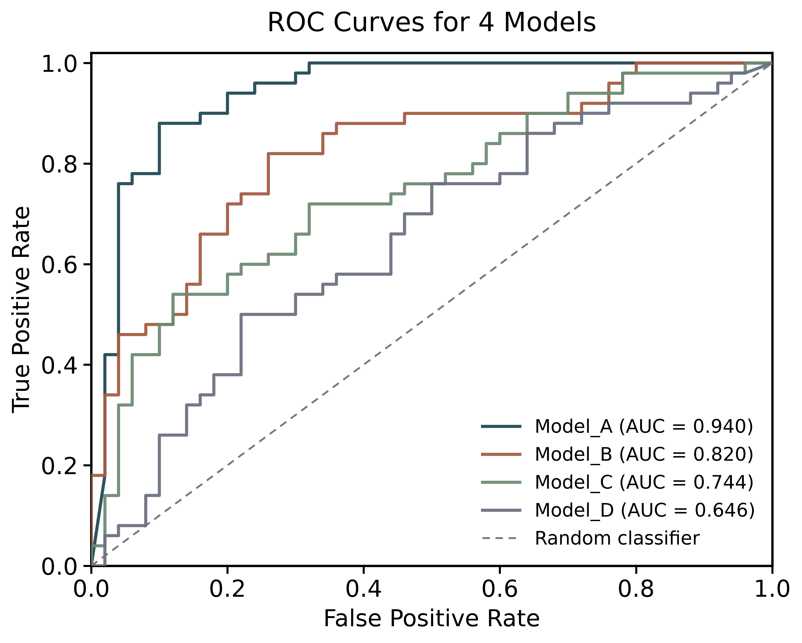
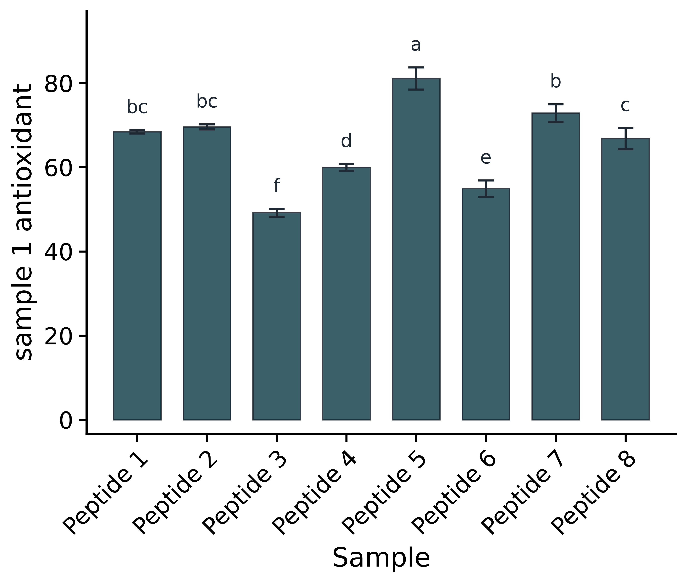
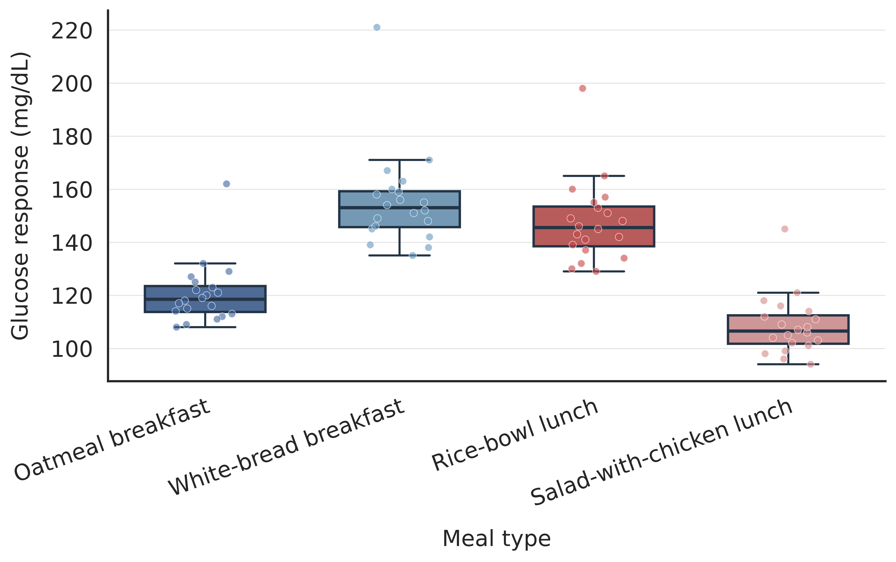
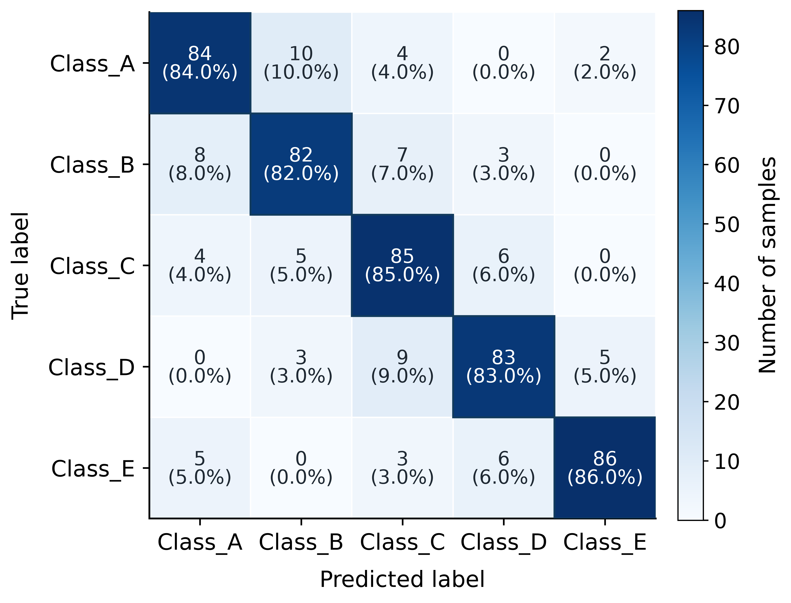
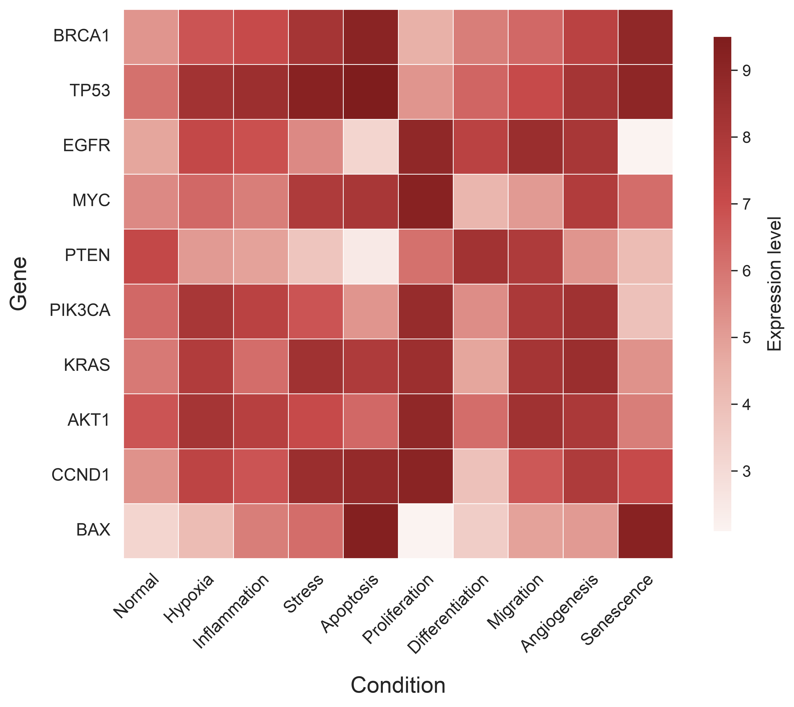
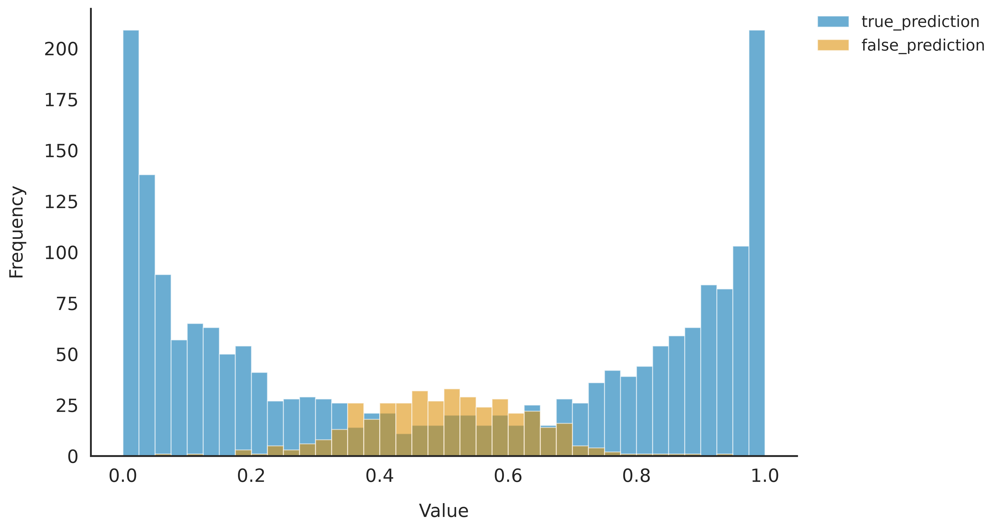
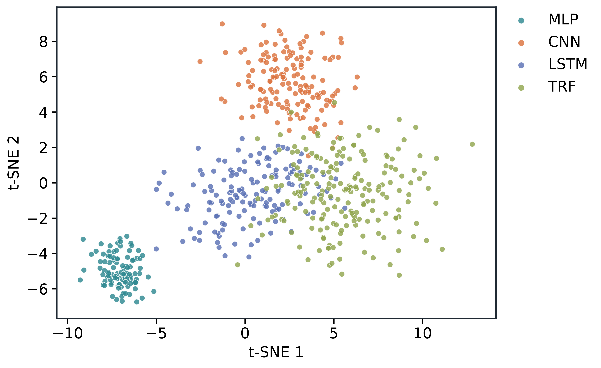

# BSEN41030 Reusable Plotting Template

<p align="center">
  <strong>A classroom-ready collection of reusable plots for food, health, science and engineering data</strong><br>
  <sub>Python scripts · Jupyter Notebooks · sample data · publication-style figure outputs</sub>
</p>

<p align="center">
  <a href="https://github.com/dzjxzyd/BSEN41030-reusable-plotting-template/tree/main">Browse the repository</a>
  ·
  <a href="https://github.com/dzjxzyd/BSEN41030-reusable-plotting-template/issues">Report an issue</a>
</p>

---

## What is inside?

This repository was prepared for **BSEN41030** teaching and demonstration activities. Each folder is a small, reusable example that can be copied, adapted and connected to a new dataset.

| Folder | Main examples |
|---|---|
| `AUC-ROC/` | ROC curves and AUC comparison |
| `bar-chart-demo/` | Bar charts using sample Excel data |
| `boxplot/` | Boxplots with and without individual data points |
| `confusion-matrix/` | Confusion matrices for multi-class results |
| `heat-map/` | Heatmaps for engineering, clinical and biological data |
| `histogram/` | Histograms for distributions and prediction scores |
| `predicted-actual-plot/` | Predicted-versus-actual plots and R² examples |
| `scatter-chart-demo/` | Scatter plots and t-SNE visualisation |

## Representative figures

The gallery below shows representative output files already included in the repository. Click any figure to open its source image; the corresponding folder also contains the Python script and/or notebook used to generate it.

<table>
  <tr>
    <td align="center" width="25%">
      <a href="AUC-ROC/auc_demo_data_roc.png">
        
      </a><br>
      <sub><b>AUC–ROC</b><br><a href="AUC-ROC/auc_demo_data_roc.png">source figure</a></sub>
    </td>
    <td align="center" width="25%">
      <a href="bar-chart-demo/sample-1-antioxidant_barplot.png">
        
      </a><br>
      <sub><b>Bar chart</b><br><a href="bar-chart-demo/sample-1-antioxidant_barplot.png">source figure</a></sub>
    </td>
    <td align="center" width="25%">
      <a href="boxplot/blood_glucose_meal_response_synthetic_boxplot_with_points.png">
        
      </a><br>
      <sub><b>Boxplot</b><br><a href="boxplot/blood_glucose_meal_response_synthetic_boxplot_with_points.png">source figure</a></sub>
    </td>
    <td align="center" width="25%">
      <a href="confusion-matrix/confusion_matrix_demo_5class_confusion_matrix.png">
        
      </a><br>
      <sub><b>Confusion matrix</b><br><a href="confusion-matrix/confusion_matrix_demo_5class_confusion_matrix.png">source figure</a></sub>
    </td>
  </tr>
  <tr>
    <td align="center" width="25%">
      <a href="heat-map/gene_expression_heatmap.png">
        
      </a><br>
      <sub><b>Heatmap</b><br><a href="heat-map/gene_expression_heatmap.png">source figure</a></sub>
    </td>
    <td align="center" width="25%">
      <a href="histogram/histogram_prediction_scores_histogram.png">
        
      </a><br>
      <sub><b>Histogram</b><br><a href="histogram/histogram_prediction_scores_histogram.png">source figure</a></sub>
    </td>
    <td align="center" width="25%">
      <a href="predicted-actual-plot/synthetic_actual_vs_predicted_predicted_vs_actual.png">
        
      </a><br>
      <sub><b>Predicted vs actual</b><br><a href="predicted-actual-plot/synthetic_actual_vs_predicted_predicted_vs_actual.png">source figure</a></sub>
    </td>
    <td align="center" width="25%">
      <a href="scatter-chart-demo/tsne_demo_data_tsne_scatter.png">
        
      </a><br>
      <sub><b>t-SNE scatter</b><br><a href="scatter-chart-demo/tsne_demo_data_tsne_scatter.png">source figure</a></sub>
    </td>
  </tr>
</table>

## Getting started

Clone the repository and install the common dependencies:

```bash
git clone https://github.com/dzjxzyd/BSEN41030-reusable-plotting-template.git
cd BSEN41030-reusable-plotting-template

python -m venv .venv
source .venv/bin/activate        # macOS/Linux
# .venv\\Scripts\\activate       # Windows

python -m pip install -r requirements.txt
```

Launch the notebooks with:

```bash
jupyter lab
```

Alternatively, run an individual Python example:

```bash
python AUC-ROC/auc_roc.py
```

## Reusing an example

1. Choose the plotting folder closest to your application.
2. Replace the sample CSV or Excel data with your own data.
3. Update labels, colours, titles and output paths in the script or notebook.
4. Run the example and review the generated plot.

The examples are designed to be adapted rather than used as a single fixed package.

## File types

The repository includes:

- Python scripts (`.py`)
- Jupyter Notebooks (`.ipynb`)
- CSV and Excel input data
- PNG and PDF example figures

The examples use demonstration or synthetic data unless otherwise indicated. Generated cache files and operating-system metadata are intentionally excluded from the repository.
